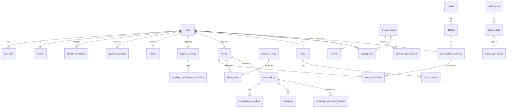

# Data model

MySQL 8, InnoDB, `utf8mb4_0900_ai_ci`. The SQL in `backend/migrations/` is the source of
truth; this file is generated from it (column lists) plus the owner of each table. Rules:

- Ids `BIGINT UNSIGNED` (catalogue tables `INT UNSIGNED`). Times `DATETIME(3)` in **UTC**.
  Money `INT UNSIGNED` **paise**. Percentages from config in **basis points** (`_bp`).
- Sensitive PII: `<name>_enc` (AES-256-GCM, with `key_version`), `<name>_hash`
  (HMAC-SHA256 for equality lookup), `<name>_last4` for masked display. See [security.md](security.md#pii-inventory).
- No foreign keys (Lambda-friendly migrations, soft deletes); integrity is enforced in
  services and covered by tests. Index every column you filter on.
- Soft delete / hide with `status` columns. "Visible" means `status` is `visible`/`active`/
  `published` as relevant; every list query filters on it.
- **Owner** = the only module that writes the table (see [architecture.md](architecture.md#modules-and-owners)).
  Everyone else reads.
- Migrations are numbered, forward-only and run by `cmd/migrate` (tracked in
  `schema_migrations`). Never edit a migration after it ran in a shared environment; add a new one.

## Entity overview

## 0001_users_auth.sql

### `users`

Owner: **user (auth inserts; verification/guardian set their status columns; moderation sets status)**  
Columns: `id`, `mobile_enc`, `mobile_hash`, `mobile_last4`, `display_name`, `primary_role`, `status`, `onboarding_step`, `verification_status`, `is_minor`, `guardian_consent_status`, `suspended_reason`, `last_login_at`, `created_at`, `updated_at`, `deleted_at`  
Keys: `PRIMARY KEY (id)`; `UNIQUE KEY uq_users_mobile_hash (mobile_hash)`

### `user_roles`

Owner: **user**  
Columns: `user_id`, `role`, `created_at`  
Keys: `PRIMARY KEY (user_id, role)`

### `refresh_tokens`

Owner: **auth**  
Refresh tokens for both app users and admins. Only the SHA-256 hash of the token is stored.  
Columns: `id`, `subject_type`, `subject_id`, `token_hash`, `family_id`, `device_id`, `expires_at`, `revoked_at`, `replaced_by`, `created_at`  
Keys: `PRIMARY KEY (id)`; `UNIQUE KEY uq_refresh_token_hash (token_hash)`

### `guardian_consents`

Owner: **guardian**  
Columns: `id`, `user_id`, `guardian_name_enc`, `guardian_mobile_enc`, `guardian_mobile_hash`, `guardian_mobile_last4`, `relation`, `status`, `policy_document_id`, `key_version`, `granted_at`, `revoked_at`, `revoked_reason`, `created_at`, `updated_at`  
Keys: `PRIMARY KEY (id)`

### `identity_verifications`

Owner: **verification**  
One row per verification attempt. The full Aadhaar number, XML, PDF and photo are NEVER stored. subject_hash = HMAC of the provider's stable subject id (e.g. DigiLocker id) to stop one identity creating many accounts.  
Columns: `id`, `user_id`, `provider`, `provider_ref`, `status`, `subject_hash`, `aadhaar_last4`, `name_enc`, `dob_enc`, `gender`, `key_version`, `failure_reason`, `verified_at`, `created_at`, `updated_at`  
Keys: `PRIMARY KEY (id)`; `UNIQUE KEY uq_identity_subject (subject_hash)`

### `media_uploads`

Owner: **media**  
Every file a client uploads. The backend builds s3_key; clients only ever see upload ids.  
Columns: `id`, `user_id`, `purpose`, `s3_key`, `content_type`, `size_bytes`, `status`, `created_at`, `confirmed_at`  
Keys: `PRIMARY KEY (id)`; `UNIQUE KEY uq_media_key (s3_key)`

### `user_settings`

Owner: **user**  
Columns: `user_id`, `notification_prefs`, `privacy`, `updated_at`  
Keys: `PRIMARY KEY (user_id)`

### `policy_acceptances`

Owner: **user**  
Columns: `id`, `user_id`, `policy_document_id`, `accepted_at`  
Keys: `PRIMARY KEY (id)`; `UNIQUE KEY uq_policy_accept (user_id, policy_document_id)`

## 0002_sports_profiles.sql

### `sports`

Owner: **appconfig (sport reads)**  
Columns: `id`, `code`, `name`, `is_team_sport`, `icon_key`, `active`, `sort_order`, `created_at`, `updated_at`  
Keys: `PRIMARY KEY (id)`; `UNIQUE KEY uq_sports_code (code)`

### `sport_positions`

Owner: **appconfig (sport reads)**  
Columns: `id`, `sport_id`, `code`, `name`, `applies_to`, `active`, `sort_order`  
Keys: `PRIMARY KEY (id)`; `UNIQUE KEY uq_sport_position (sport_id, code)`

### `stat_templates`

Owner: **appconfig (sport reads)**  
fields: [{"key":"runs","label":"Runs","type":"int","unit":null}, ...] type is one of int | decimal | text | duration_ms | percent  
Columns: `id`, `sport_id`, `position_id`, `name`, `fields`, `version`, `active`, `created_at`  
Keys: `PRIMARY KEY (id)`

### `profiles`

Owner: **profile**  
Columns: `user_id`, `bio`, `sport_id`, `position_id`, `city`, `district`, `state`, `academy_club`, `photo_upload_id`, `birth_year`, `visibility`, `stats_visibility`, `coaching_since_year`, `followers_count`, `following_count`, `created_at`, `updated_at`  
Keys: `PRIMARY KEY (user_id)`

### `profile_sports`

Owner: **profile**  
Columns: `user_id`, `sport_id`, `position_id`, `is_primary`  
Keys: `PRIMARY KEY (user_id, sport_id)`

### `user_stats`

Owner: **profile**  
Columns: `id`, `user_id`, `sport_id`, `template_id`, `season`, `stats`, `created_at`, `updated_at`  
Keys: `PRIMARY KEY (id)`; `UNIQUE KEY uq_user_stats_season (user_id, sport_id, season)`

### `achievements`

Owner: **profile**  
Columns: `id`, `user_id`, `sport_id`, `title`, `description`, `level`, `achieved_on`, `certificate_upload_id`, `created_at`, `updated_at`  
Keys: `PRIMARY KEY (id)`

### `follows`

Owner: **follow**  
Columns: `follower_id`, `followee_id`, `created_at`  
Keys: `PRIMARY KEY (follower_id, followee_id)`

### `blocks`

Owner: **follow**  
Columns: `blocker_id`, `blocked_id`, `created_at`  
Keys: `PRIMARY KEY (blocker_id, blocked_id)`

### `profile_views`

Owner: **profile**  
One row per (viewer, viewed, day). Powers the see_profile_viewers premium benefit. Views by minors are never recorded.  
Columns: `viewed_id`, `viewer_id`, `viewed_on`, `created_at`  
Keys: `PRIMARY KEY (viewed_id, viewed_on, viewer_id)`

### `organiser_profiles`

Owner: **organiser**  
Columns: `user_id`, `org_name`, `org_type`, `status`, `reviewed_by`, `review_note`, `submitted_at`, `reviewed_at`, `created_at`, `updated_at`  
Keys: `PRIMARY KEY (user_id)`

### `organiser_verification_submissions`

Owner: **organiser**  
Columns: `id`, `user_id`, `step_id`, `value_text`, `document_upload_id`, `status`, `reviewed_by`, `review_note`, `created_at`, `reviewed_at`  
Keys: `PRIMARY KEY (id)`; `UNIQUE KEY uq_org_submission (user_id, step_id)`

### `coach_consultations`

Owner: **consultation**  
Coach consultation listing (payments happen directly between player and coach).  
Columns: `user_id`, `offered`, `description`, `fee_note`, `modes`, `updated_at`  
Keys: `PRIMARY KEY (user_id)`

### `consultation_requests`

Owner: **consultation**  
Columns: `id`, `coach_id`, `player_id`, `message`, `preferred_mode`, `status`, `created_at`, `updated_at`  
Keys: `PRIMARY KEY (id)`

## 0003_events_listing.sql

### `events`

Owner: **event (listingpayment: status on payment; registration: registrations_count; moderation: status)**  
Columns: `id`, `organiser_id`, `sport_id`, `title`, `description`, `event_type`, `participant_type`, `team_size_min`, `team_size_max`, `competition_level`, `gender_category`, `age_min`, `age_max`, `venue_name`, `address_line`, `city`, `district`, `state`, `pincode`, `latitude`, `longitude`, `starts_at`, `ends_at`, `registration_deadline`, `entry_fee_paise`, `payment_modes`, `payment_instructions`, `max_slots`, `rules`, `prize_info`, `contact_name`, `contact_phone_enc`, `contact_phone_last4`, `key_version`, `banner_upload_id`, `status`, `rejection_reason`, `cancel_reason`, `registrations_count`, `featured_at`, `published_at`, `cancelled_at`, `completed_at`, `created_at`, `updated_at`  
Keys: `PRIMARY KEY (id)`

### `event_registrations`

Owner: **registration**  
Columns: `id`, `event_id`, `user_id`, `team_name`, `team_members`, `status`, `payment_status`, `payment_note`, `created_at`, `updated_at`  
Keys: `PRIMARY KEY (id)`; `UNIQUE KEY uq_registration (event_id, user_id)`

### `listing_fee_rules`

Owner: **listingpayment**  
Listing fee = clamp(percent_bp/10000 * entry_fee_paise * max_slots, min_fee, max_fee) + GST. Most specific active rule wins: (sport+type) > sport > type > default (both NULL); ties by priority DESC.  
Columns: `id`, `name`, `sport_id`, `event_type`, `percent_bp`, `min_fee_paise`, `max_fee_paise`, `free_event_fee_paise`, `gst_bp`, `priority`, `active`, `effective_from`, `effective_to`, `created_by`, `created_at`, `updated_at`  
Keys: `PRIMARY KEY (id)`

### `listing_orders`

Owner: **listingpayment**  
The fee is snapshotted here so later config changes never change a past order.  
Columns: `id`, `event_id`, `organiser_id`, `fee_rule_id`, `entry_fee_paise`, `max_slots`, `percent_bp`, `gst_bp`, `base_fee_paise`, `gst_paise`, `total_paise`, `currency`, `provider`, `provider_order_id`, `provider_payment_id`, `status`, `refund_paise`, `provider_refund_id`, `refund_reason`, `paid_at`, `refunded_at`, `expires_at`, `created_at`, `updated_at`  
Keys: `PRIMARY KEY (id)`; `UNIQUE KEY uq_listing_provider_order (provider, provider_order_id)`

### `payment_webhook_events`

Owner: **listingpayment (razorpay) / subscription (stores)**  
Idempotency log for payment-provider webhooks. Payloads are NOT stored (they contain payer PII).  
Columns: `id`, `provider`, `provider_event_id`, `event_type`, `entity_id`, `status`, `received_at`, `processed_at`  
Keys: `PRIMARY KEY (id)`; `UNIQUE KEY uq_webhook_event (provider, provider_event_id)`

## 0004_social_chat.sql

### `posts`

Owner: **feed (moderation: status)**  
Columns: `id`, `author_id`, `body`, `media_upload_ids`, `sport_id`, `event_id`, `visibility`, `like_count`, `comment_count`, `status`, `created_at`, `updated_at`  
Keys: `PRIMARY KEY (id)`

### `post_likes`

Owner: **feed**  
Columns: `post_id`, `user_id`, `created_at`  
Keys: `PRIMARY KEY (post_id, user_id)`

### `post_comments`

Owner: **feed (moderation: status)**  
Columns: `id`, `post_id`, `author_id`, `body`, `status`, `created_at`  
Keys: `PRIMARY KEY (id)`

### `conversations`

Owner: **chat (direct, event) / community (community); moderation: status**  
type=direct: exactly 2 members, direct_key = "<minUserId>:<maxUserId>". type=community: user-created group. type=event: auto-created group for a published event.  
Columns: `id`, `type`, `title`, `description`, `avatar_upload_id`, `owner_id`, `event_id`, `sport_id`, `city`, `state`, `visibility`, `join_policy`, `direct_key`, `member_count`, `last_message_id`, `last_message_at`, `status`, `created_at`, `updated_at`  
Keys: `PRIMARY KEY (id)`; `UNIQUE KEY uq_conversations_direct (direct_key)`; `UNIQUE KEY uq_conversations_event (event_id)`

### `conversation_members`

Owner: **chat / community**  
Columns: `conversation_id`, `user_id`, `role`, `status`, `muted_until`, `last_read_message_id`, `joined_at`, `updated_at`  
Keys: `PRIMARY KEY (conversation_id, user_id)`

### `messages`

Owner: **chat (moderation: status)**  
Columns: `id`, `conversation_id`, `sender_id`, `kind`, `body`, `media_upload_id`, `reply_to_id`, `client_msg_id`, `status`, `created_at`, `edited_at`  
Keys: `PRIMARY KEY (id)`; `UNIQUE KEY uq_messages_client (sender_id, client_msg_id)`

### `notifications`

Owner: **notification**  
Columns: `id`, `user_id`, `type`, `title`, `body`, `data`, `read_at`, `created_at`  
Keys: `PRIMARY KEY (id)`

### `device_tokens`

Owner: **notification**  
Columns: `id`, `user_id`, `platform`, `token`, `app_version`, `last_seen_at`, `created_at`  
Keys: `PRIMARY KEY (id)`; `UNIQUE KEY uq_device_token (token)`

## 0005_billing_moderation_admin.sql

### `premium_plans`

Owner: **subscription**  
Columns: `id`, `code`, `audience`, `name`, `description`, `price_paise`, `billing_period`, `store_product_id_android`, `store_product_id_ios`, `active`, `sort_order`, `created_at`, `updated_at`  
Keys: `PRIMARY KEY (id)`; `UNIQUE KEY uq_premium_plan_code (code)`

### `premium_plan_benefits`

Owner: **subscription**  
benefit_key values are a closed list in docs/config-system.md (e.g. consultation_listing, profile_boost, advanced_stats, see_profile_viewers, extra_communities, verified_coach_badge).  
Columns: `id`, `plan_id`, `benefit_key`, `value`, `label`, `sort_order`  
Keys: `PRIMARY KEY (id)`; `UNIQUE KEY uq_plan_benefit (plan_id, benefit_key)`

### `subscriptions`

Owner: **subscription**  
Columns: `id`, `user_id`, `plan_id`, `store`, `store_transaction_id`, `purchase_token_hash`, `status`, `auto_renew`, `started_at`, `expires_at`, `created_at`, `updated_at`  
Keys: `PRIMARY KEY (id)`; `UNIQUE KEY uq_subscription_store_txn (store, store_transaction_id)`

### `ad_campaigns`

Owner: **ads**  
Columns: `id`, `advertiser_name`, `title`, `body`, `image_upload_id`, `target_url`, `placement`, `sport_id`, `state`, `priority`, `starts_at`, `ends_at`, `status`, `created_by`, `created_at`, `updated_at`  
Keys: `PRIMARY KEY (id)`

### `ad_daily_stats`

Owner: **ads**  
Columns: `ad_id`, `stat_date`, `impressions`, `clicks`  
Keys: `PRIMARY KEY (ad_id, stat_date)`

### `reports`

Owner: **moderation**  
Columns: `id`, `reporter_id`, `target_type`, `target_id`, `reason`, `details`, `status`, `resolved_by`, `resolution_note`, `created_at`, `resolved_at`  
Keys: `PRIMARY KEY (id)`; `UNIQUE KEY uq_reports_once (reporter_id, target_type, target_id)`

### `moderation_actions`

Owner: **moderation**  
Columns: `id`, `admin_id`, `target_type`, `target_id`, `action`, `reason`, `report_id`, `created_at`  
Keys: `PRIMARY KEY (id)`

### `admin_roles`

Owner: **admin**  
permissions: JSON array of permission strings (closed list in docs/security.md).  
Columns: `id`, `name`, `description`, `permissions`, `created_at`, `updated_at`  
Keys: `PRIMARY KEY (id)`; `UNIQUE KEY uq_admin_roles_name (name)`

### `admin_users`

Owner: **admin**  
Columns: `id`, `email`, `name`, `password_hash`, `totp_secret_enc`, `key_version`, `role_id`, `status`, `failed_logins`, `locked_until`, `last_login_at`, `created_at`, `updated_at`  
Keys: `PRIMARY KEY (id)`; `UNIQUE KEY uq_admin_email (email)`

### `admin_audit_log`

Owner: **append-only via platform/audit**  
Columns: `id`, `admin_id`, `action`, `target_type`, `target_id`, `details`, `ip`, `created_at`  
Keys: `PRIMARY KEY (id)`

## 0006_config.sql

### `app_config`

Owner: **appconfig**  
Columns: `id`, `config_key`, `value`, `value_type`, `category`, `description`, `is_public`, `version`, `updated_by`, `updated_at`  
Keys: `PRIMARY KEY (id)`; `UNIQUE KEY uq_app_config_key (config_key)`

### `config_audit`

Owner: **append-only via platform/audit**  
Change history for every config-like table (app_config, listing_fee_rules, premium_plans, premium_plan_benefits, policy_documents, verification_requirements, organiser_verification_steps, sports).  
Columns: `id`, `table_name`, `record_id`, `old_value`, `new_value`, `changed_by`, `changed_at`  
Keys: `PRIMARY KEY (id)`

### `policy_documents`

Owner: **appconfig**  
Columns: `id`, `doc_type`, `version`, `title`, `content_md`, `requires_acceptance`, `active`, `effective_from`, `created_by`, `created_at`  
Keys: `PRIMARY KEY (id)`; `UNIQUE KEY uq_policy_version (doc_type, version)`

### `verification_requirements`

Owner: **appconfig**  
What each role must complete, and which action it gates.  
Columns: `id`, `role`, `requirement`, `is_required`, `gates`, `updated_at`  
Keys: `PRIMARY KEY (id)`; `UNIQUE KEY uq_verification_req (role, requirement, gates)`

### `organiser_verification_steps`

Owner: **appconfig**  
Columns: `id`, `step_code`, `title`, `description`, `input_type`, `is_required`, `sort_order`, `active`, `updated_at`  
Keys: `PRIMARY KEY (id)`; `UNIQUE KEY uq_org_step_code (step_code)`

## 0008_location_identity.sql

### `states`

Owner: **locationidentity (admin: geo.write)**  
Columns: `id`, `code`, `name`, `is_ut`, `lgd_code`, `active`  
Keys: `PRIMARY KEY (id)`; `UNIQUE KEY uq_states_code (code)`; `UNIQUE KEY uq_states_name (name)`

### `districts`

Owner: **locationidentity (admin: geo.write)**  
Full district list: import the official LGD file with `make import-districts FILE=...` (cmd/admincli import-districts). Admins can add districts later (new districts are created every year). Seeded below: Tamil Nadu, as the reference example.  
Columns: `id`, `state_id`, `name`, `lgd_code`, `aliases`, `active`  
Keys: `PRIMARY KEY (id)`; `UNIQUE KEY uq_districts_state_name (state_id, name)`; `UNIQUE KEY uq_districts_lgd (lgd_code)`

### `user_location_identities`

Owner: **locationidentity**  
One row per submission. History is kept (superseded / expired / rejected rows stay). At most ONE verified and ONE pending row per (user, type): enforced by the generated slots.  
Columns: `id`, `user_id`, `identity_type`, `district_id`, `state_id`, `proof_type`, `'rent_agreement','utility_bill','bank_statement','voter_id',`, `'employer_letter','institution_id')`, `proof_holder`, `proof_upload_id`, `aadhaar_last4`, `notice_version`, `status`, `rejection_code`, `rejection_reason`, `submitted_at`, `reviewed_at`, `reviewed_by`, `verified_at`, `expires_at`, `expiry_reminded_at`, `proof_purged_at`, `updated_at`, `verified_slot`, `pending_slot`  
Keys: `PRIMARY KEY (id)`; `UNIQUE KEY uq_loc_verified (user_id, verified_slot)`; `UNIQUE KEY uq_loc_pending (user_id, pending_slot)`

### Columns added by 0008 to existing tables

- `events` (owner **event**): `category` (government / private), `eligibility_type`
  (open / native / residence / either), `eligibility_scope` (district / state),
  `eligibility_district_id`, `eligibility_state_id`, `require_verified`; key
  `idx_events_eligibility (status, eligibility_type, eligibility_district_id, eligibility_state_id)`.
- `event_registrations` (owner **registration**): `qualified_via`, `qualified_identity_id`,
  `qualified_district_id`, `eligibility_flag` (none / identity_expired / identity_rejected /
  identity_revoked / identity_changed), `eligibility_flagged_at`; key `idx_registrations_identity`.
- `media_uploads.purpose` gains `location_proof`; `policy_documents.doc_type` gains
  `location_identity_notice`.
- `user_location_identities.verified_slot` / `pending_slot` are generated columns: with the
  unique keys on `(user_id, slot)` they allow at most one verified and one pending identity per
  type per user (MySQL has no partial unique index).

## 0010_admin_security.sql

### `admin_login_events`

Owner: **admin**  
One row per admin login attempt (success or failure). `email_hash` is the HMAC of the
lower-cased email; `admin_id` is NULL for unknown emails. Never holds passwords, TOTP codes or
the raw email. Rows older than `admin.login_events_retention_days` are deleted by the
`admin.purge_login_events` job.  
Columns: `id`, `admin_id`, `email_hash`, `ip`, `user_agent`, `outcome`, `reason`, `created_at`  
Keys: `PRIMARY KEY (id)`

## 0011_events_ads_moderation.sql

- `reports.target_type` gains `community` (a community is reported as itself, not as its
  conversation).

## 0012_social.sql

### `community_ownership_transfers`

Owner: **community**  
One row per `POST /communities/:id/transfer-ownership`.  
Columns: `id`, `conversation_id`, `from_user_id`, `to_user_id`, `created_at`  
Keys: `PRIMARY KEY (id)`

- `conversations.removal_reason` (VARCHAR 500): the reason an admin gives on
  `POST /admin/communities/:id/remove`.

## 0013_location.sql

- `user_location_identities.review_note` (VARCHAR 255): optional note an admin writes when
  approving. Shown to admins only, never to the user; no PII.
