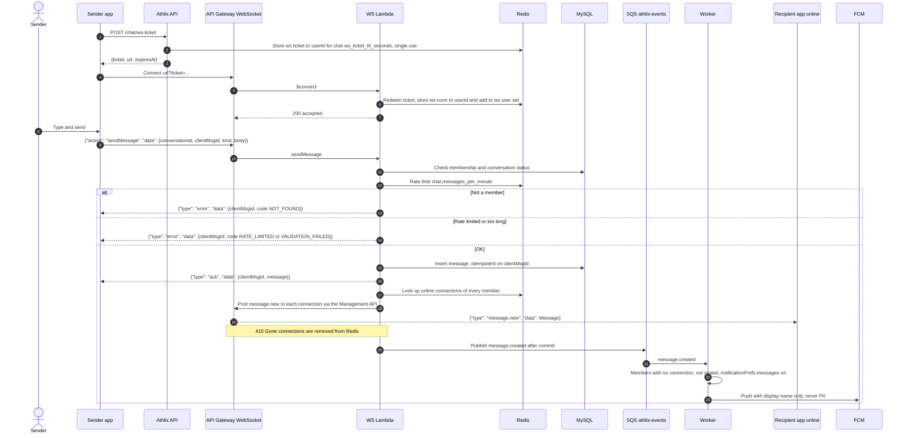
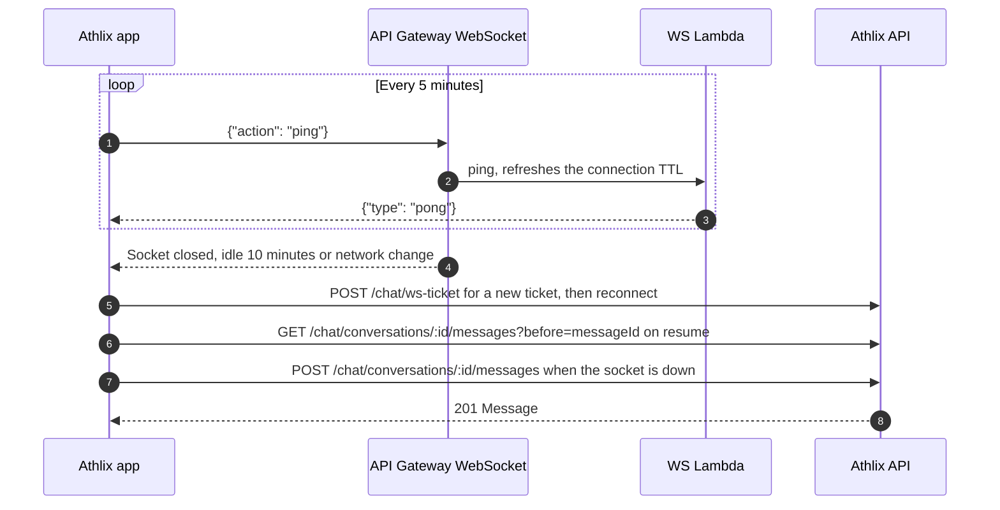

# Chat: ticket, connect, send, fan-out, push

Messages are saved in MySQL first, then pushed over WebSocket to members who are online, then
the `message.created` event makes the notification module push to members who are offline and
have not muted the conversation. The same send function is used by REST, the local WebSocket
route and the `ws` Lambda.

In AWS the socket is an **API Gateway WebSocket API** routed to the `ws` Lambda (`$connect`,
`$disconnect`, `sendMessage`, `typing`, `markRead`, `ping`). Locally `cmd/api` serves
`GET /chat/ws` with an in-memory hub and the same frames.

## Connect and send

- `clientMsgId` makes sending safe to retry: the same id returns the same message.
- Limits: `chat.message_max_length`, `chat.messages_per_minute` (429), images only when
  `chat.media_enabled` and with a `chat_image` upload (`mediaUploadId`).
- Other frames: `{"action": "typing"}` → `{"type": "typing"}` to members;
  `{"action": "markRead"}` → `{"type": "read"}`; deletes fan out `{"type": "message.deleted"}`.

## Keep-alive and fallback

The app must work without the socket: REST send, and poll `GET .../messages` on resume.

## Who can start a DM

`POST /chat/direct {userId}` (and `Profile.canMessage`) passes only if all hold:

1. Not blocked either way; the recipient finished onboarding and is active.
2. The recipient's `privacy.allowDmsFrom` (`everyone`, `followers`, `mutual`, `nobody`); with
   `chat.dm_requires_follow` at least `followers`.
3. If either person is a minor, `minor.dm_policy` (`none`, `mutual_follow`, `anyone`).
4. For two adults, an `accepted` consultation passes rule 2.

Failure: 403 `FORBIDDEN` "You can't message this person." Event groups are created on
`event.published` (if `event.auto_create_group`) and membership follows
`registration.created`, `registration.withdrawn` and `registration.promoted`.
