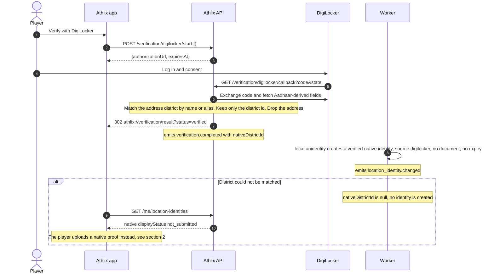
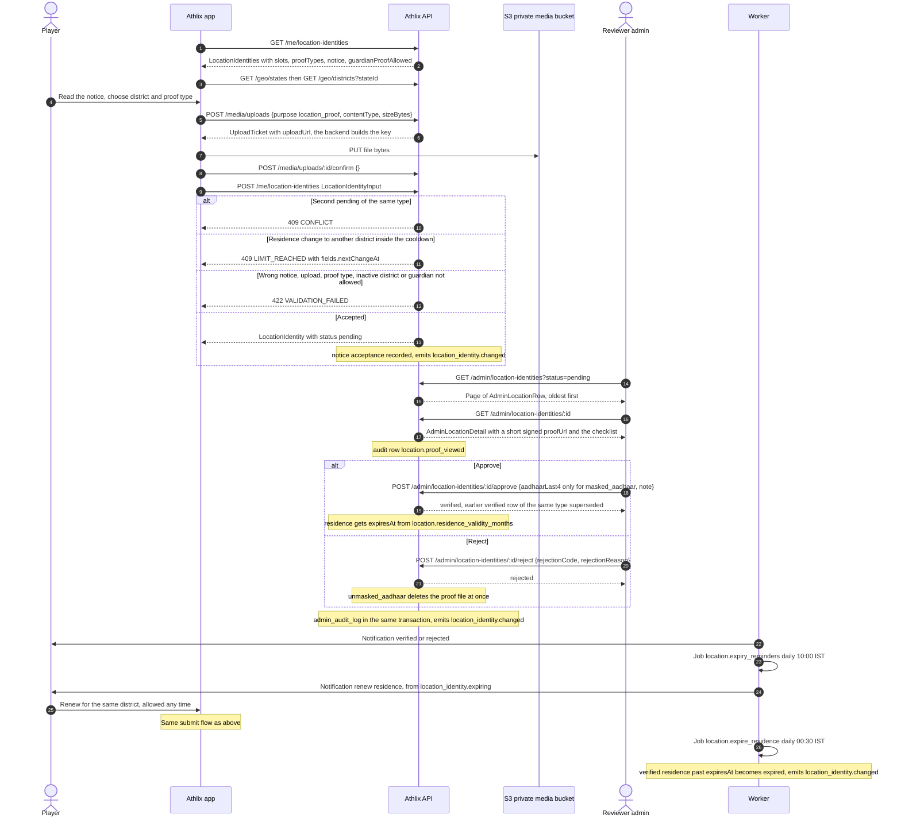
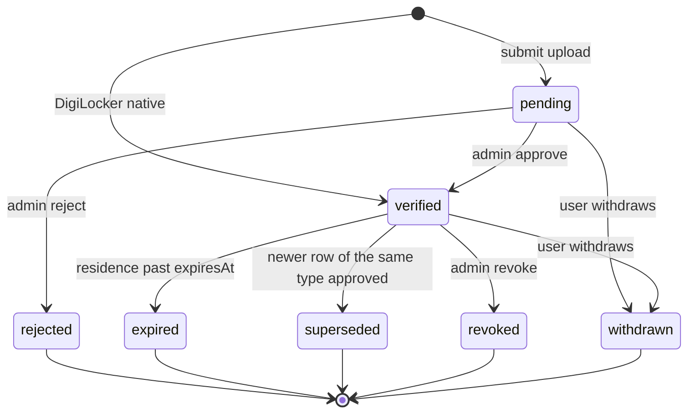
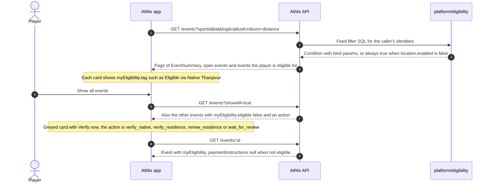
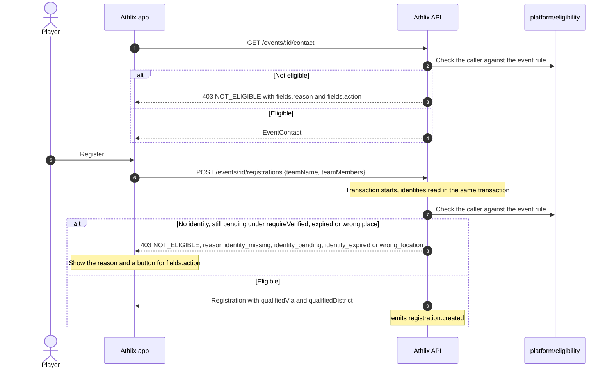
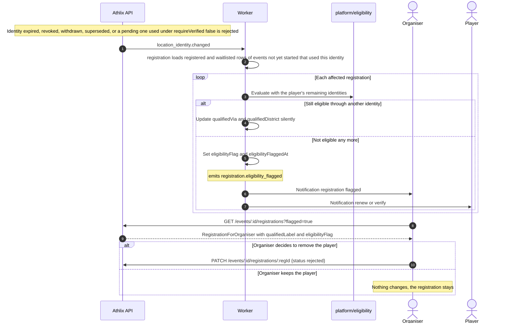
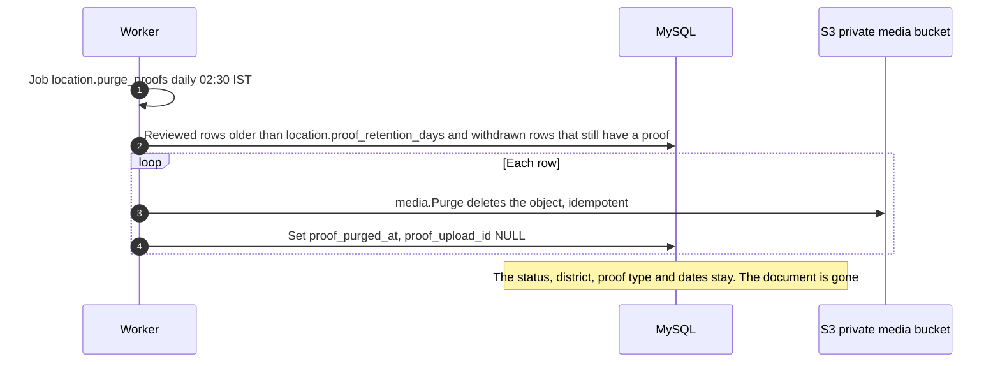

# Location eligibility

Some tournaments are only for players **from** a place (native, proven by official ID) or
**living in** it (residence, proven by an address proof), at district or state level. The
organiser sets `category` (`government` or `private`) and an `eligibility` rule on the event;
the server checks the player's **location identities** against it in the feed, on the event
page, before revealing payment details, and inside the registration transaction.

- One rule implementation: `platform/eligibility`. Event, registration and search all call it.
- Only the **district** (and its state) is kept, never the address. Aadhaar: last 4 digits at most.
- Proof files are visible only to admins with `location.review`, through short signed URLs
  (every view is audited), and are deleted `location.proof_retention_days` after review.
- Registrations are **flagged, never cancelled**, when the qualifying identity stops being valid.
- `location.enabled = false` turns the feature off: every event behaves as `open`.

Contract: [api.md](../api.md) sections "Location identity" and "Location identities and
districts", [architecture.md](../architecture.md) "Location eligibility",
[config-system.md](../config-system.md) `location.*`.

## 1. Native identity from DigiLocker

When DigiLocker verification succeeds, the Aadhaar address district is matched to the
`districts` table (by name or alias) and a verified native identity is created automatically.

- Native identities never expire. A later reviewed native change (for example a birth
  certificate) is allowed only when `location.native_change_allowed` is true (else 409
  `INVALID_STATE`); on approval the old row becomes `superseded`.

## 2. Upload, review, verified, expiry and renewal

The same flow is used for a native upload (`location.native_proof_types`) and for residence
(`location.residence_proof_types`). Residence expires; native does not.

- A user has at most one verified and one pending identity per type (unique slots in the DB).
- Minors may submit a parent or guardian address proof for residence
  (`proofHolder: guardian`) when `location.minor_guardian_proof_allowed` is true.
- Revoke (`POST /admin/location-identities/:id/revoke {reason}`) is only for verified rows,
  for example fraud. Withdraw is `DELETE /me/location-identities/:id`; it deletes the proof at once.
- Reviewer checklist values come from config: `location.utility_bill_max_age_days`,
  `location.rejection_reasons`.

## 3. Feed filter and showAll

- `lat` and `lng` are sent per request and never stored. `radiusKm` is 1 to
  `event.max_search_radius_km`.
- The same filter applies to `GET /events/featured` and search.

## 4. Register check and NOT_ELIGIBLE

- `requireVerified: false` lets a pending identity qualify; if that pending row is later
  rejected, section 5 applies.
- Waitlist promotion re-checks eligibility; a waitlisted player who is no longer eligible is
  skipped and flagged.
- Only the registrant is checked. Team members are names only.

## 5. Identity change flags registrations, never cancels

- `eligibilityFlag` values: `identity_expired`, `identity_rejected`, `identity_revoked`,
  `identity_changed`.
- Off when `location.flag_registrations_on_change` is false. The system never cancels a
  registration on its own.

## 6. Proof purge

- Seed default: 30 days (`location.proof_retention_days`).
- Deleted earlier: on rejection with `unmasked_aadhaar`, on withdrawal, and when the account is
  deleted (`user.deleted`).
- After the purge the admin detail returns `proofUrl: null` and `proofPurgedAt`.

Author: Atindraa.
