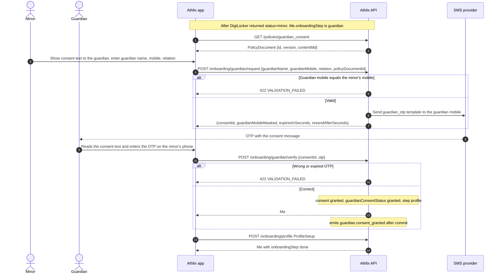
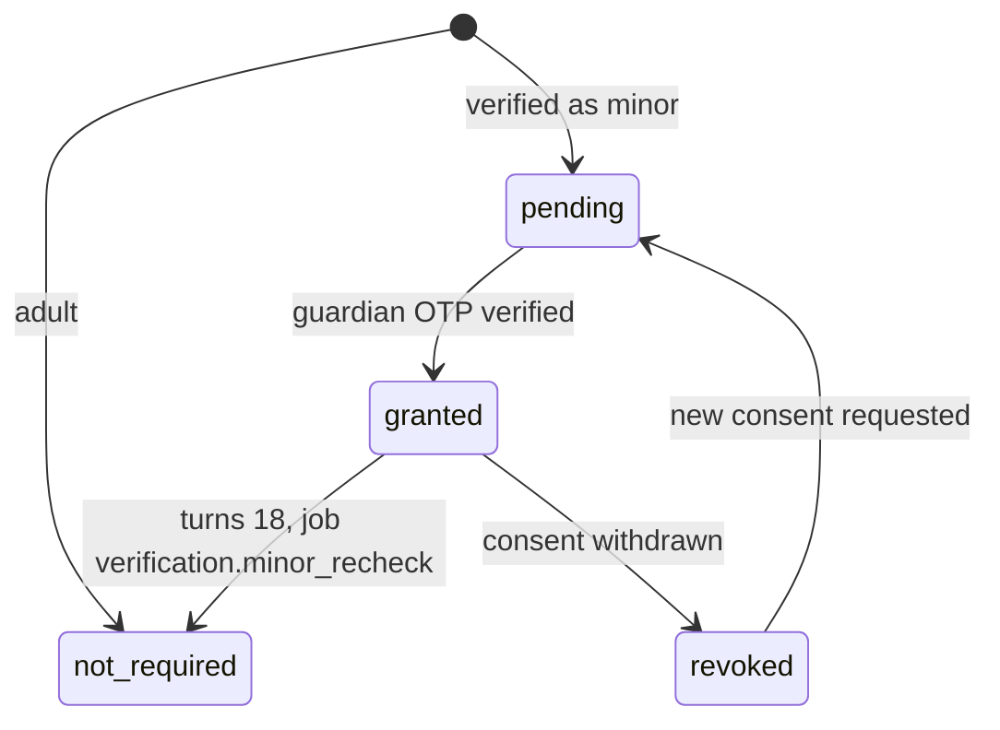
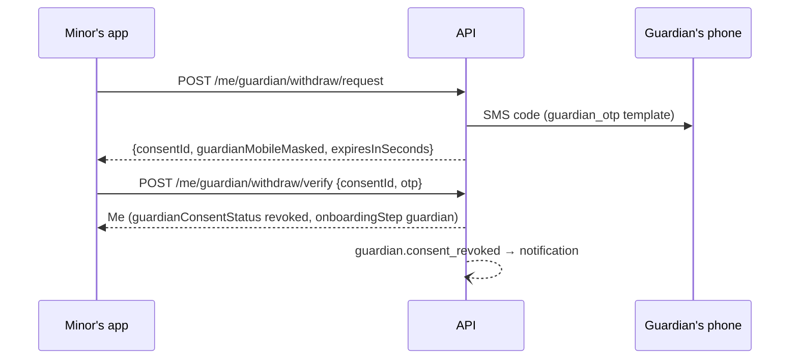

# Minor sign-up and guardian consent

Minors may use Athlix with a parent's or guardian's consent. A user is a minor when the
DigiLocker DOB gives an age below `guardian.minor_age_years` (default 18, the DPDP definition
of a child; do not lower it). Below `auth.min_age_years` (default 10) the user is refused.
The requirement comes from `verification_requirements` (`guardian_consent_if_minor` /
`app_access`, required for every role by default).

The consent OTP goes to the **guardian's** mobile, which must differ from the minor's own
mobile. The guardian's name and mobile are stored encrypted (`guardian_consents`, `_enc`,
`_hash`, `_last4`), with the relation, the consent policy version and the time.

## Sequence

The OTP is valid for `guardian.consent_otp_ttl_seconds` (default 600).

## Consent status

## Withdrawing consent

- Only a minor whose consent is `granted` can start it (Settings → "Withdraw guardian
  consent"). The code goes to the **guardian's** mobile, so the minor cannot withdraw alone.
- On success the consent row gets `revoked_at` and `revoked_reason = guardian_withdrew`, and the
  app's router sends the user back to the guardian step. Until a new consent is granted the
  account cannot use verified features.
- Support can revoke consent too: `POST /admin/users/:id/guardian-consent/revoke {reason}`
  (`users.write`, audited), shown on the admin user page for minors with granted consent.

## What changes for a minor (enforced in the backend)

| Rule | Config | Default |
|---|---|---|
| Who can DM a minor (checked in both directions) | `minor.dm_policy` | `mutual_follow` |
| Consultation DM exception | (none) | never applies to minors |
| Default profile visibility, `public` refused | `minor.profile_default_visibility` | `followers` |
| City hidden from non-followers | (fixed rule) | on |
| Appears in people search, without photo, city and bio unless mutual follow | `minor.searchable` | `true` |
| May join public communities; invites follow the DM rule | `minor.can_join_public_communities` | `true` |
| Sponsored placements | `ads.show_to_minors` | `false` (keep it) |
| Profile views by a minor are not recorded | (fixed rule) | on |
| Posts default to followers when the profile default is not public | (fixed rule) | on |
| `underage_safety` reports first in the admin queue | (fixed rule) | on |

## Open points

- An OTP proves control of the guardian's mobile, not that the guardian is an adult. Whether
  this is "verifiable" parental consent under the DPDP Rules is for the lawyer
  ([compliance.md](../business/compliance.md#childrens-data)).
