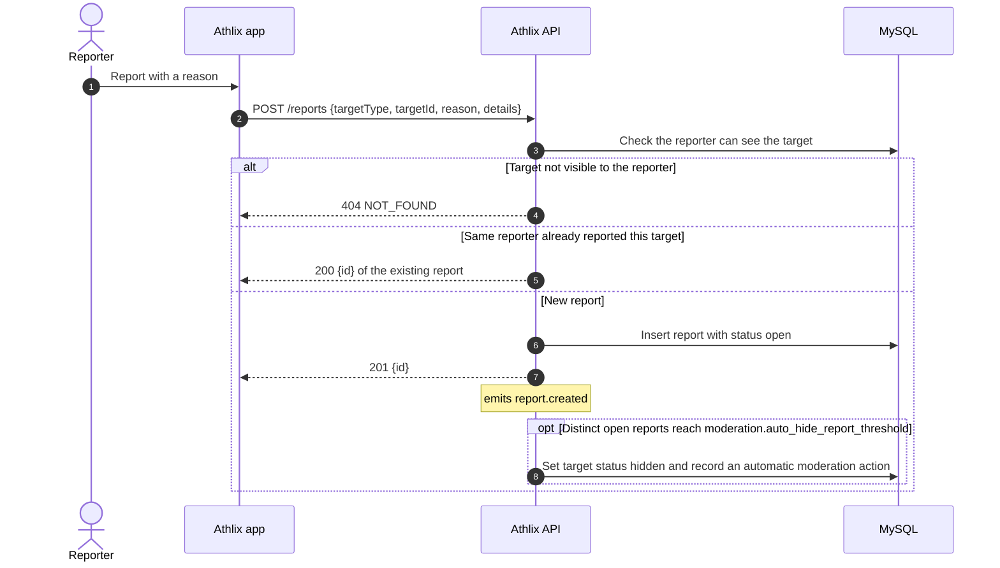
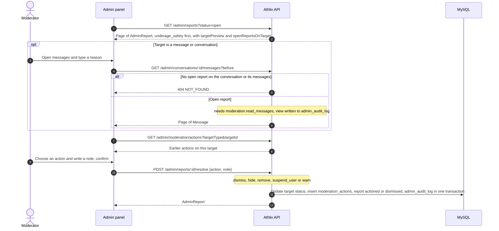
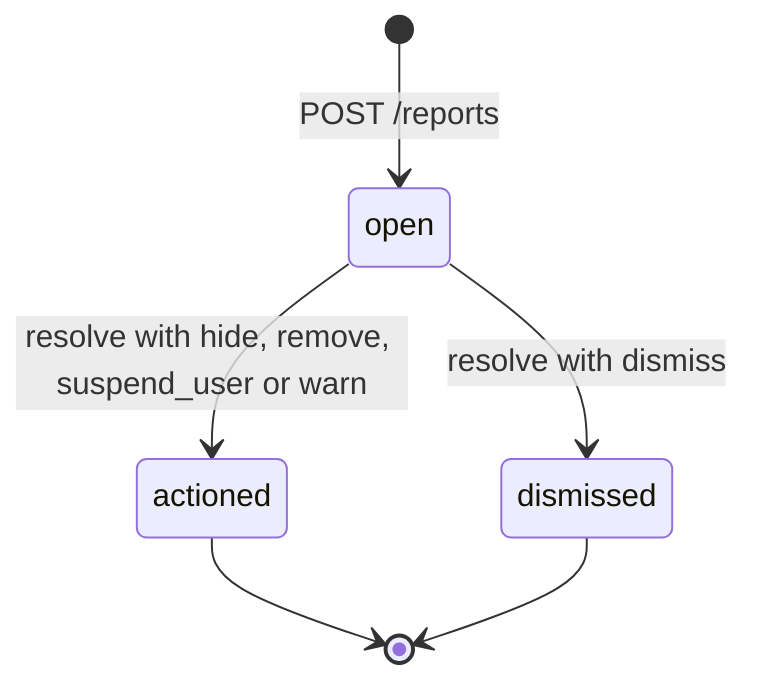
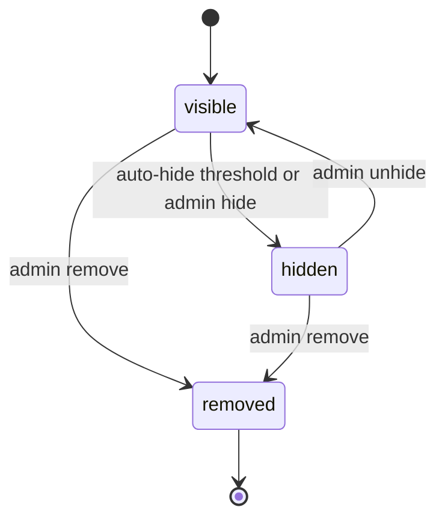

# Moderation

Any verified user can report a user, event, post, comment, message or conversation. Content
auto-hides when enough distinct people report it, and admins work a queue with
`underage_safety` reports first. Reading the messages of a reported conversation needs a
separate permission, is allowed only while a report is open, and is audited.

## Report and auto-hide

`reason`: `spam`, `fake_profile`, `harassment`, `scam`, `inappropriate`, `underage_safety`,
`payment_issue`, `other`. Reports are rate limited (`report:<userId>`, 20 per hour).
Auto-hidden content is invisible to everyone except moderators until an admin decides.

## Admin review

- Permissions: `reports.read` (queue, history), `reports.resolve` (resolve, direct actions),
  `moderation.read_messages` (reported conversations), `communities.moderate`
  (`GET /admin/communities`, `POST /admin/communities/:id/remove`), `users.write`
  (`POST /admin/users/:id/suspend`, `/unsuspend`).
- Direct action without a report: `POST /admin/moderation/actions {targetType, targetId,
  action, reason}` with `hide`, `unhide`, `remove`, `suspend_user`, `unsuspend_user`, `warn`.
- `moderation` is the only module allowed to change the `status` column of `users`, `events`,
  `posts`, `post_comments`, `messages` and `conversations`; owners treat `hidden`, `removed`
  and `suspended` as invisible.
- A suspended user gets 403 `ACCOUNT_SUSPENDED` on every app route.
- Removing a published event uses `POST /admin/events/:id/remove` (no listing refund; see
  [tournament-listing.md](tournament-listing.md)).

## Report status

## Content status

Whether dismissing a report automatically un-hides auto-hidden content is a moderation module
rule; check its README. If not, the moderator uses `unhide` explicitly.
