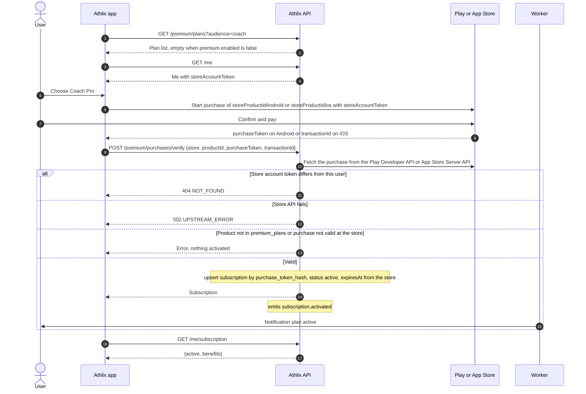
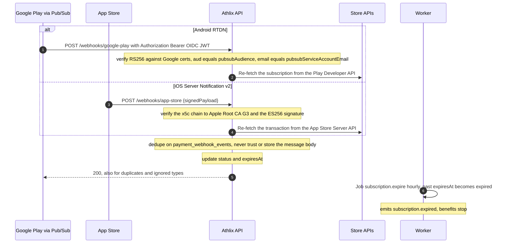
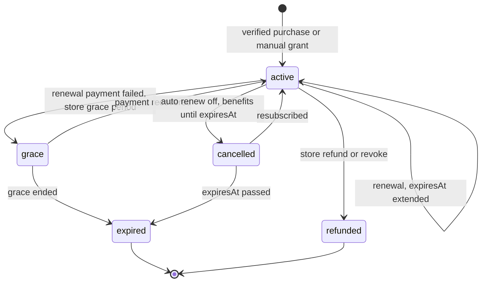

# Premium purchase

Premium plans are auto-renewing subscriptions sold through **Google Play Billing** and
**Apple in-app purchase**. Plans, prices, store product ids and benefits are rows in
`premium_plans` / `premium_plan_benefits`. The server verifies every purchase with the store
and never trusts the client. Plans are shown only when `premium.enabled` is true.

Purchases are bound to the Athlix account by `Me.storeAccountToken` (a UUID derived from a
keyed hash of the user id), passed to the store as Play `obfuscatedAccountId` / Apple
`appAccountToken`. A purchase carrying another account's token is refused (404), so a
receipt cannot be claimed by someone else. Purchase tokens are stored only as a SHA-256 hash.

## Buy and verify

- Verify is idempotent: the same purchase verified twice returns the same subscription.
- Benefits come from the closed list in [config-system.md](../config-system.md#premium-benefits-closed-list);
  if several active plans share a key, the larger value wins.
- `POST /premium/mock/activate {planId}` replaces the store outside prod.
- Admins can grant a plan manually: `POST /admin/subscriptions/grant {userId, planId, days, reason}`
  (store `manual`, permission `plans.write`).

## Renewals, cancellations, refunds

## Subscription status

