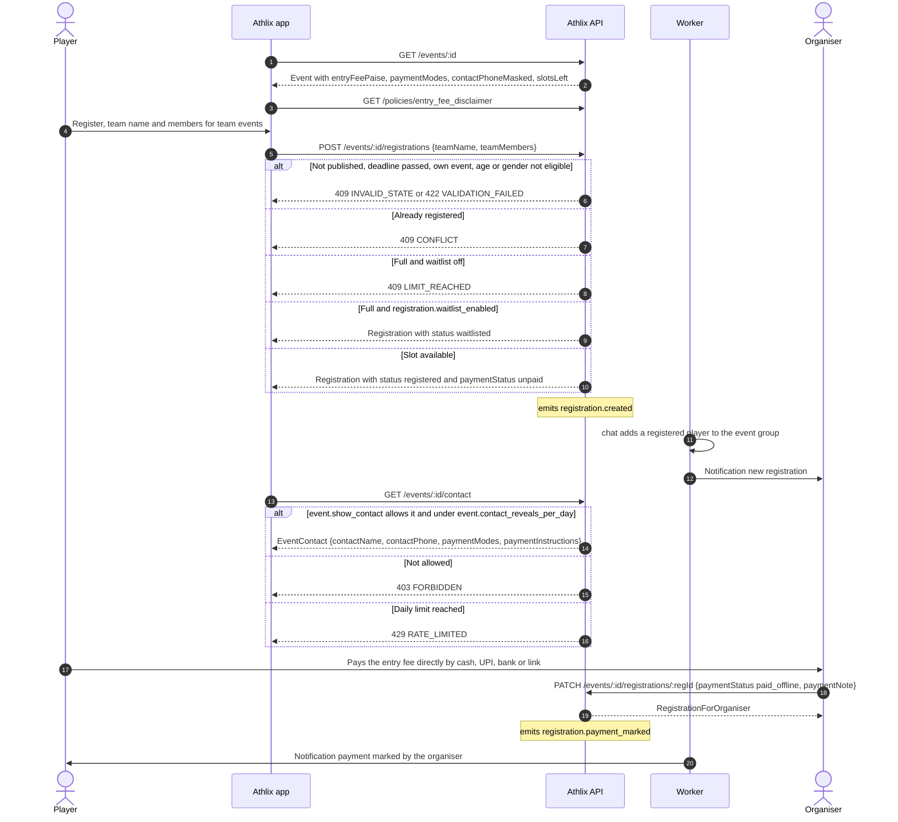
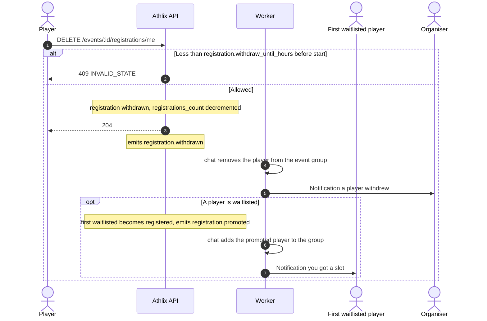
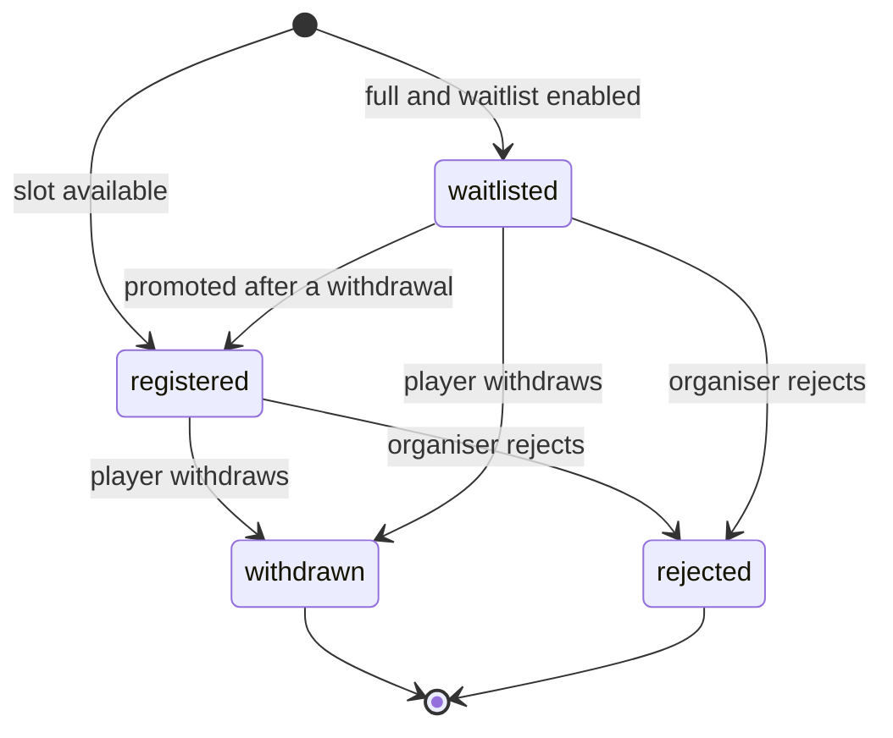

# Event registration

A player registers for a published event (or joins the waitlist), sees the organiser's
contact and payment instructions, and **pays the organiser directly** (cash, UPI, bank
transfer or the organiser's own link). The organiser marks the registration as paid; Athlix
only records it. The registration screen shows the `entry_fee_disclaimer` policy.

## Register, reveal contact, pay offline

- `event.show_contact`: `always`, or `after_registration` (default: the caller needs a
  `registered` or `waitlisted` registration). The owner can always see it. Reveals are limited
  per user per day by `event.contact_reveals_per_day` (anti-scraping).
- `paymentStatus` values: `unpaid`, `paid_online` (paid on the organiser's own link),
  `paid_offline`, `waived`. Athlix never verifies or holds the money.
- The organiser can reject a registration: `PATCH ... {status: "rejected"}`.
- Organiser lists: `GET /events/:id/registrations?status` (owner only, else 404).
- Player list: `GET /me/registrations?status`.
- Eligibility: age from the verified birth year against `ageMin` / `ageMax` (unknown is
  allowed); `genderCategory` male / female against the verified gender. Max 30 team members.
- Registered players get a reminder `notification.event_reminder_hours` before the start
  (job `notification.event_reminders`).

## Withdraw and waitlist promotion

Any entry fee already paid is settled between player and organiser; Athlix does not refund
entry fees.

## Registration status

If the event is cancelled or removed, every registered player is notified through
`event.cancelled` ([tournament-listing.md](tournament-listing.md)).
