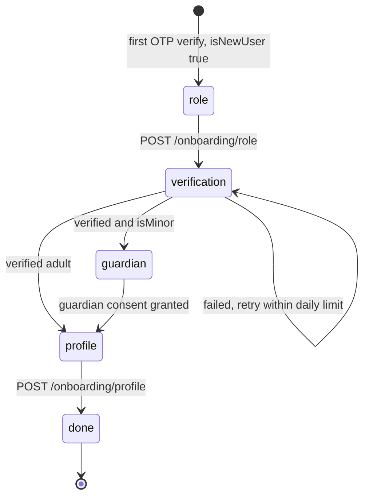
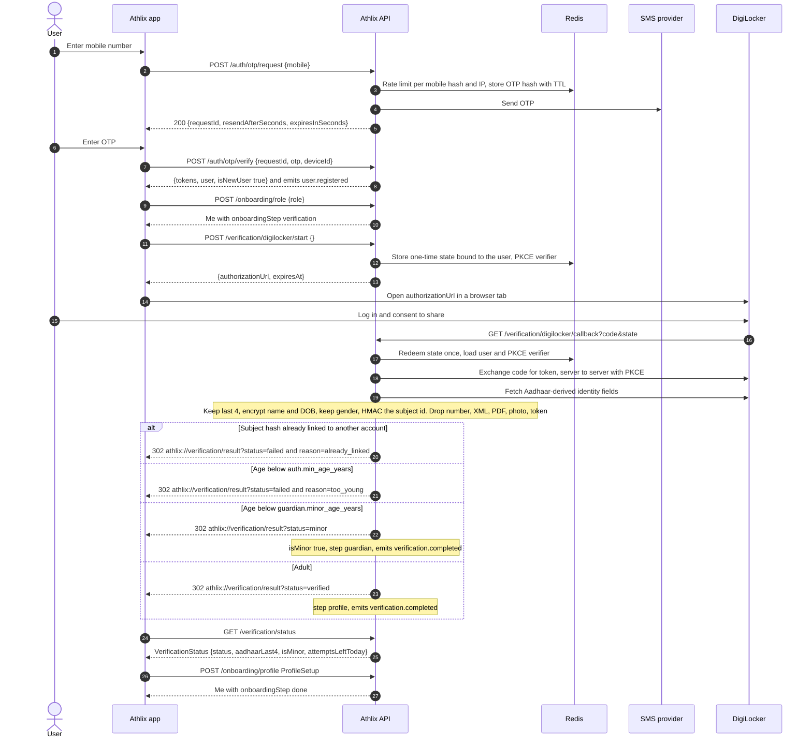

# Sign-up and DigiLocker verification

A new user signs in with a mobile OTP, picks a role, verifies identity and age with DigiLocker,
and completes a profile. The **server** does the DigiLocker OAuth2 code exchange (with PKCE);
the app only opens a browser tab and receives a deep link. Athlix keeps the Aadhaar **last 4
digits**, encrypted name and DOB, gender, and a keyed hash of the provider subject id. The full
Aadhaar number, XML, PDF, photo and the DigiLocker access token are thrown away.

Whether a role needs DigiLocker comes from `verification_requirements` (`digilocker` /
`app_access`, required for every role by default).

## Onboarding steps

If DigiLocker is not required for the user's roles, `role` goes straight to `profile`. Until
the step is `done`, every `verified` route answers 403 `ONBOARDING_REQUIRED` with
`fields.nextStep`.

## Sequence

## Rules

- OTP: `auth.otp.length`, `auth.otp.ttl_seconds`, `auth.otp.max_attempts` wrong codes burn the
  request, `auth.otp.resend_cooldown_seconds`, `auth.otp.max_per_hour` per mobile and per IP.
  `otp/request` returns 200 for any valid number (does not reveal whether the user exists).
- The DigiLocker `state` is single-use, bound to the user and valid
  `verification.state_ttl_seconds`. Attempts are limited by
  `verification.max_attempts_per_day` (429).
- The provider is chosen by `verification.provider`: `digilocker_direct`, `aggregator` or
  `mock`. `mock` (`POST /verification/mock/complete`) works only when ENV is not prod.
- `profiles.birth_year` is set from the verified DOB and used for age checks; the job
  `verification.minor_recheck` clears `is_minor` after the 18th birthday.
- Minors continue at [minor-consent.md](minor-consent.md).
- New policy versions that need acceptance appear in `Me.pendingPolicies`; the app blocks
  until `POST /me/policies/accept`.
