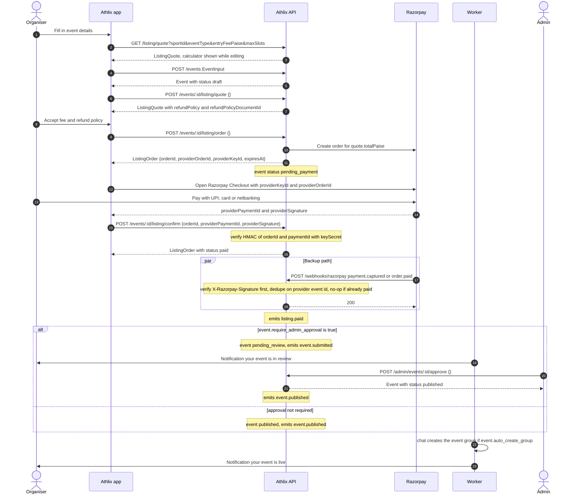
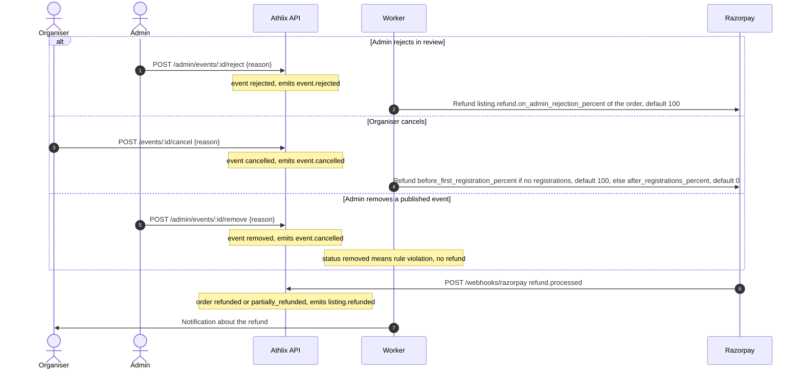
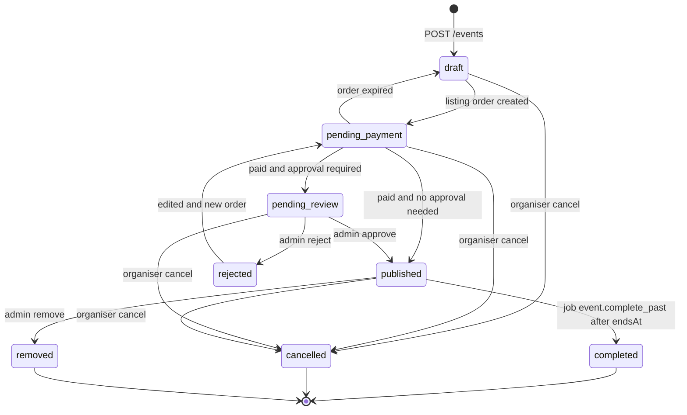
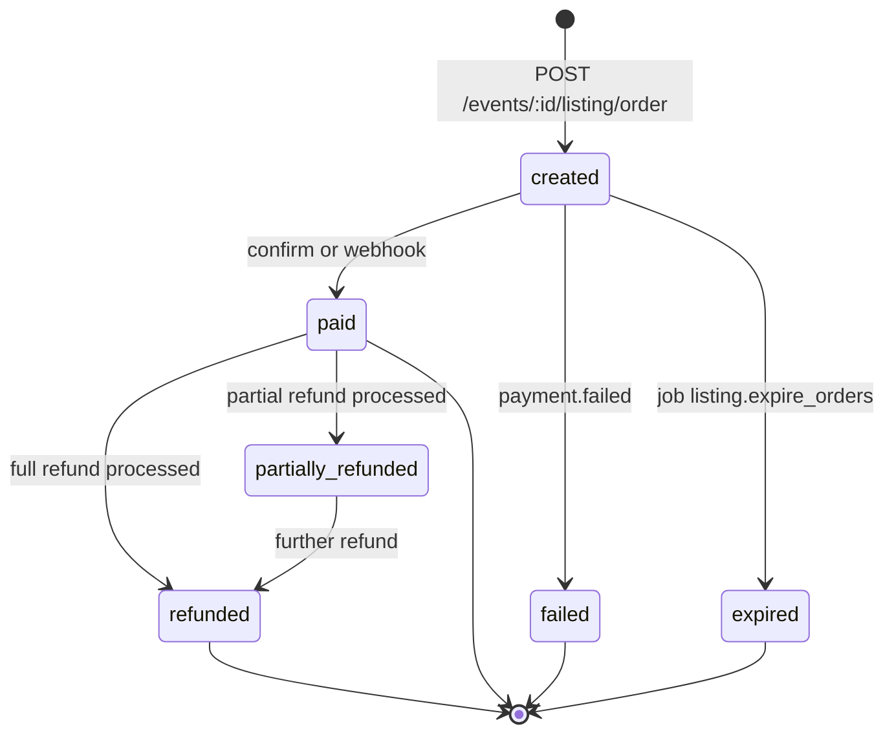

# Tournament listing (listing fee)

An organiser creates an event, sees the listing fee, pays it through Razorpay, and (by default)
waits for admin review before the event is published. **Only the listing fee goes through
Athlix.** Entry fees are paid by players directly to the organiser
([registration.md](registration.md)).

Before creating events the organiser needs role `organiser` and, when
`verification_requirements` (`organiser_approval` / `create_event`) says so, an approved
organiser profile (403 `ORGANISER_NOT_APPROVED`).

## Fee

```
base  = entryFeePaise == 0 ? freeEventFeePaise : clamp(round(entryFeePaise × maxSlots × percentBp / 10000), minFeePaise, maxFeePaise)
total = base + round(base × gstBp / 10000)
```

From the most specific active `listing_fee_rules` row. Default: 5 %, min ₹99, max ₹4,999,
₹99 for free events, 18 % GST. ₹500 × 16 = ₹8,000 → ₹400 + ₹72 GST = **₹472**. The quote is
snapshotted on the order.

## Pay and publish



- A quote with `totalPaise` 0 (for example a 0 % promotional rule) is marked paid at once, with
  provider `none`.
- Only one open (`created`) order per event; a new order request returns it if the quote is
  unchanged, else expires it and creates a new one.
- `confirm` and the webhook are both idempotent; whichever arrives first marks the order paid.
- Webhook payloads are never stored; only `payment_webhook_events(provider, provider_event_id)`
  for dedupe. A bad signature gets 400 / 401 without a reason.
- `POST /listing/mock/pay` replaces Razorpay when `listing.payment_provider` is `mock` (ENV not prod).

## Unpaid order expiry

The job `listing.expire_orders` (every 15 minutes) moves `created` orders past `expiresAt`
(`listing.order_ttl_minutes`, default 30) to `expired` and the event back to `draft`.
`payment.failed` from the webhook marks the order `failed`; the organiser can order again.

## Refunds: reject, cancel, remove



- The refund runs in `listingpayment` as a handler of `event.rejected` / `event.cancelled`,
  idempotent per order; a 0 % refund does nothing.
- Finance can also refund manually: `POST /admin/listing-orders/:id/refund {amountPaise, reason}`
  (permission `payments.refund`).
- `event.cancelled` also archives the event group chat and notifies every registered player.
- A rejected event is editable and can be resubmitted with a new order.

## Event status



## Listing order status



## Editing after payment

`pending_review` events cannot be edited (409). Published events may change only
`description, rules, prizeInfo, paymentInstructions, bannerUploadId, contactName,
contactPhone, venueName, addressLine`; the fee inputs (`entryFeePaise`, `maxSlots`) and dates
are locked. Edits emit `event.updated`, which notifies registered players.
